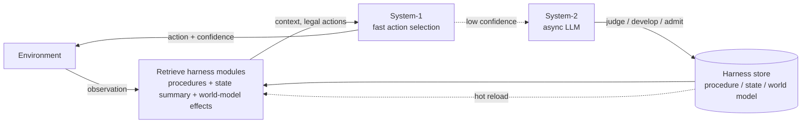

# JevRSI

[](https://arxiv.org/abs/2611.22432)
[](LICENSE)

**Paper:** [Think Once, Act Fast](https://arxiv.org/abs/2611.22432) — arXiv:2611.22432

**JevRSI** is a System-1/System-2 collaboration framework that turns LLM
reasoning into transferable decision support through recursive harness
improvement. A Jev-style System-1 model provides low-latency action selection,
while an asynchronous System-2 LLM develops a modular harness around it.

> Fast System-1 models enable responsive actions but struggle with complex or
> unfamiliar tasks. Large language model (LLM)-based System-2 provides strong
> reasoning capabilities, yet repeated invocation incurs substantial latency and
> computational costs. To bridge this gap, we propose **JevRSI**, a
> System-1/System-2 collaboration framework that transforms LLM reasoning into
> transferable decision support through recursive harness improvement. A
> Jev-style System-1 model enables low-latency action selection, while an
> asynchronous System-2 LLM develops a modular harness. The harness integrates
> procedures, state memory, and world models to provide decision contexts
> spanning the past, present, and future. Utility-driven retrieval selects
> modules based on both contextual relevance and their utility on previous
> tasks. Environmental feedback guides targeted revisions and enables recursive
> self-improvement. Experiments across three datasets show that JevRSI
> consistently improves decision quality, matching or surpassing LLM agents in
> several settings. It preserves low-latency execution with favorable
> performance-cost trade-offs. Moreover, System-2 development interventions
> decrease as the harness evolves, amortizing System-2 costs through continuous
> improvement.

## Ongoing 3D embodied capabilities

### A demo in RoboDojo

RoboDojo is the 3D embodied testbed for JevRSI's low-latency decision loop.
The demo shows the harness acting in a rendered 3D scene while System-2
develops reusable modules asynchronously.

https://github.com/user-attachments/assets/adf9b9c5-ce07-451d-9121-e387ee94a953

The harness has three module kinds. System-1 chooses every action; System-2
never acts instead of it. System-2 runs asynchronously, and when System-1 is
uncertain it may write or revise one module at a time.

| Module | Decision context | Stored as | What System-1 sees |
| --- | --- | --- | --- |
| **procedure** | current guidance | markdown rule | advice text (`relevant_skills`) |
| **state** | state memory / past history | Python program + JSON graph | `state_memory` graph summary |
| **world model** | future effect | Python program that predicts each action | predicted effect next to legal actions |



## The three modules

Every module is one `skills_store/<env>/<slug>.md` file. Frontmatter is common;
the body depends on `kind`.

### procedure — current guidance

```markdown
---
name: heat-food-first
kind: procedure
when: the task requires heating a cold substance
keywords: [heat, stove, microwave]
expected: the temperature reading rises
---
## Procedure
If the substance is cold and the goal is to heat it, go to the heating device
before doing anything else.
```

Retrieved every step by contextual relevance and shown as current guidance.

### state — memory of the past

The module file carries the usual frontmatter (`name`, `kind`, `when`,
`keywords`); its program defines the state abstraction:

```python
def state(goal, observation, inventory, history):
    for room in ["kitchen", "hall", "garden"]:
        if room in observation.lower():
            return room
    return "unknown"
```

System-2 develops the state-memory module; it defines what counts as an
episode state and writes the extractor that maps each observation to that
state. The graph records what earlier episodes and steps have already seen,
so it supplies past-history context. The framework executes the extractor
after every step, builds the graph (`state node --action--> state node`),
persists it under
`skills_store/<env>/_graphs/<skill>/<task>.json`, and shows a compact summary
(current node, seen nodes, outgoing edges) as `state_memory`. Keeping storage
mechanics in the framework lets System-2 focus on the memory abstraction: which
events, regions and facts are worth remembering, and how they should be named.
One state module is pinned per episode; a revision reaches the next episode.

### world model — a prediction of future effects

The world model is a program that predicts what each legal action will do now:

```python
def predict(goal, observation, inventory, history, actions, outcomes):
    return {
        action: {
            "effect": "the block becomes air",
            "same": False,
            "ends": False,
            "reward": "0",
        }
        for action in actions if "mineBlock" in action
    }
```

Its effect text is shown next to the legal action, so System-1 can distinguish
actions before executing them. The framework checks the prediction for the
executed action against the next observation; wrong predictions trigger a
targeted revision. Transition buffers and replay validation keep updates tied
to recorded train experience.

## Recursive harness improvement

- **Trigger:** System-1 confidence below `trigger.confidence_threshold`, or a
  checked world-model prediction that failed.
- The job waits `system2.process.after_steps` steps (or the episode end) so the
  judge sees what followed.
- **Judge:** one sentence of reasoning, then
  `DECISION: NONE | NEW procedure | NEW state | REVISE <name>`.
  NONE means System-1 recovered, an existing module covers the situation, or
  nothing generalizes beyond this episode.
- **Develop:** exactly one module. Admission checks structure, size, and
  state-program compilation plus replay on the recorded episode. One fix turn
  is allowed. A world model is admitted on its accuracy over recorded train
  transitions and rejected if it would regress the current model.
- **Publish:** System-2 is the only writer. System-1 hot-reloads the store
  before retrieval, so the next decision can use a revised module; the acting
  loop never waits for System-2.

## Retrieval and utility

- **Contextual retrieval:** BM25 ranks modules for the current task, goal,
  inventory, observation and state summary. Skills whose declared task scope
  does not cover the current task are skipped.
- **Scenario tags:** S2 writes `when`, `keywords` and `expected`; those tags
  decide whether a module applies. A cross-task module can be used when its
  scenario text explicitly covers the current task.
- **Utility:** each revision records `uses`, `successes`,
  `utility = successes/uses`, and a failure streak. Utility guides lifecycle
  decisions: three consecutive failed episodes block a module, and a revision
  resets the counters and unblocks it. The world model is scored by prediction
  accuracy rather than episode outcome.
- **Environmental feedback:** operation results, state transitions, and
  checked world-model predictions drive targeted revisions. As the harness
  matures, fewer System-2 interventions are needed, amortizing LLM cost.

## Configuration

`configs/base.yaml`:

```yaml
skills:
  dir: skills_store
  top_k: 3                 # procedures shown per step
  block_after: 3           # consecutive failures before blocking
  max_body_chars: 2000
  state:
    max_program_chars: 6000
    step_budget_ms: 50
    view_chars: 1200
    graph_nodes: 12
system2:
  backend: llm             # llm | stub | none
  process:
    after_steps: 3
    num_workers: 4
    max_fixes: 1
trigger:
  confidence_threshold: 0.5
```

`run.mode` selects `dual` (Jev + System-2), `jev` (System-2 off: no learned
skills), or `llm_agent` (the LLM decides; the same harness is available).
`llm` is the pure LLM baseline without System-2 or the harness.

## Running

Offline smoke (no model servers, deterministic stubs):

```bash
PYTHONPATH=. python -m jevmaster.cli --config configs/base.yaml \
  --env mock --mode dual --s1-backend stub --s2-backend stub --episodes 4 \
  --exp-id smoke
```

Real run (start the S1 / S2 servers first):

```bash
python -m jevmaster.cli --config configs/alfworld.yaml \
  --mode dual --s1-backend jev --s2-backend llm
# or the train -> eval protocol
python scripts/run_protocol.py --config configs/alfworld.yaml
```

## Layout

```
jevmaster/skills/
  skill.py      # the module model (procedure/state/world model) + counters
  store.py      # file store, hot reload, outcome attribution, blocking
  retrieval.py  # contextual BM25 retrieval
  state.py      # sandboxed state extractor + persisted exploration graph
  world.py      # world model (checked one-step action predictions)
  runtime.py    # per-episode wiring of the three modules
jevmaster/system2/   # async process, judge/develop/admission
jevmaster/prompts/system2.py  # concise judge + per-kind develop prompts
jevmaster/agent.py   # the decision loop
```

## Citation

If you find JevRSI useful, please cite our paper:

```bibtex
@misc{lai2026jevrsi,
  title         = {Think Once, Act Fast: Cost-Effective Recursive
                   Self-Improvement for Decision Model Harness},
  author        = {Siqi Lai and Haitao Li and Hao Liu},
  year          = {2026},
  eprint        = {2611.22432},
  archivePrefix = {arXiv},
  primaryClass  = {cs.AI},
  url           = {https://arxiv.org/abs/2611.22432}
}
```

Paper: <https://arxiv.org/abs/2611.22432>
